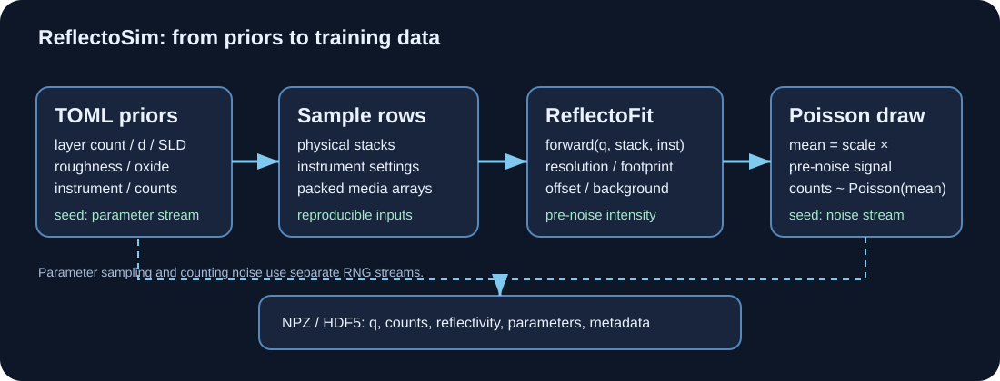
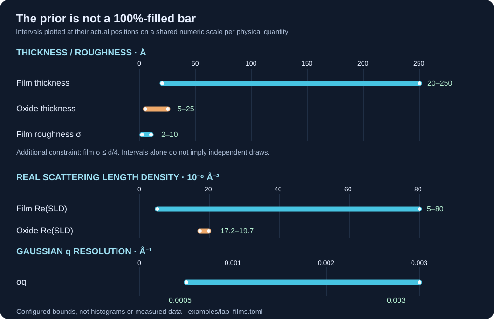
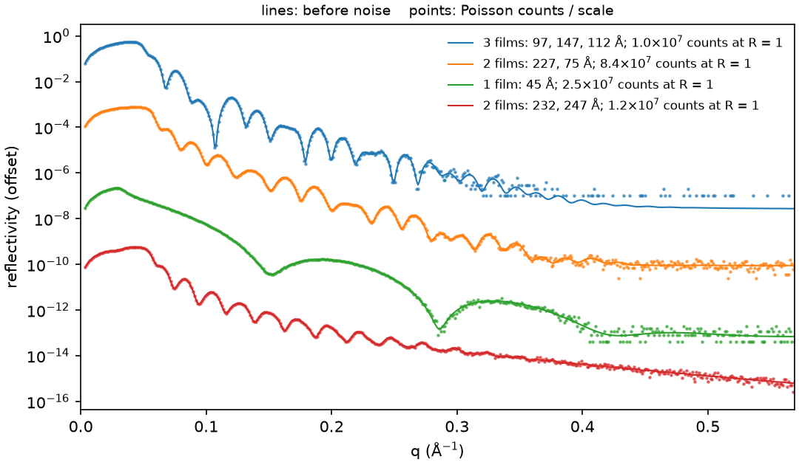

# ReflectoSim

ReflectoSim generates realistic synthetic X-ray reflectivity (XRR) curves for training and testing
inverse models. You describe a distribution, a prior over layer stacks and instruments, and it draws
curves from it with counting noise and writes them to a dataset file that records how to regenerate
it.

The structure prior covers random multilayers: layer count, thickness, roughness tied to thickness
(σ ≤ ratio · d), SLD with a minimum contrast between neighbours, absorption, and a native oxide
whose position you must state (on the substrate, on top, or none). The instrument prior covers
resolution, 2θ offset, I0, background, Cu Kα₂, footprint and counting statistics. Counts are Poisson,
with optional dark counts and read noise.

The curves come from the forward model of [ReflectoFit](https://github.com/NaNIsaac/ReflectoFit),
the fitting engine; ReflectoSim adds the data distribution and has no physics of its own. Before
noise, every curve equals `reflectofit.forward` for its row, a curve does not depend on how the work
is chunked, and the same seed gives the same file.

The same seed gives the same file only with the same ReflectoFit version and settings. The parameters
and the noise use separate random streams, so the parameters of a seed never depend on the curves.
The counts do: NumPy's Poisson sampler draws a number of random numbers that depends on the expected
counts, so a change to the curves (another ReflectoFit version, another node count) changes the
counts of every later curve in the same 4096-row noise block, not only of the curves that changed.

## Visual documentation







Read the [visual guide](visual-guide.md) for parameter units, the structure diagram, interpretation of the curves and scientific caveats.

## Install

Not on PyPI yet. From a clone, with [uv](https://docs.astral.sh/uv/) (it fetches ReflectoFit from
GitHub):

```sh
git clone https://github.com/NaNIsaac/ReflectoSim
cd ReflectoSim
uv sync
```

## First run

Simulate 1000 curves of one to three films on SiO₂ on Si from the example prior and summarise the
file:

```sh
uv run reflectosim sim --prior examples/lab_films.toml --n 1000 --seed 20261024,1 -o train.npz
uv run reflectosim describe train.npz
```

The dataset layout, the prior file format and the Python API are in the
[README](https://github.com/NaNIsaac/ReflectoSim#readme).

## Accuracy and cost

By default the resolution integral uses ReflectoFit's per-point rule: each window is split at the
critical edges and refined between them, within 1e-4 of a brute-force convolution on ReflectoFit's
confirmation grids, real SLDs and superlattices included, at about 0.75 s for 64 curves of 2000
points (ReflectoFit#8). `InstrumentPrior.nodes` fixes a node count instead; a fixed count is not
accurate at the edges of non-absorbing films, and per NaNIsaac DECISIONS #24 it is for generators
who state an error budget against the counting noise in advance and record it in the dataset
metadata.
