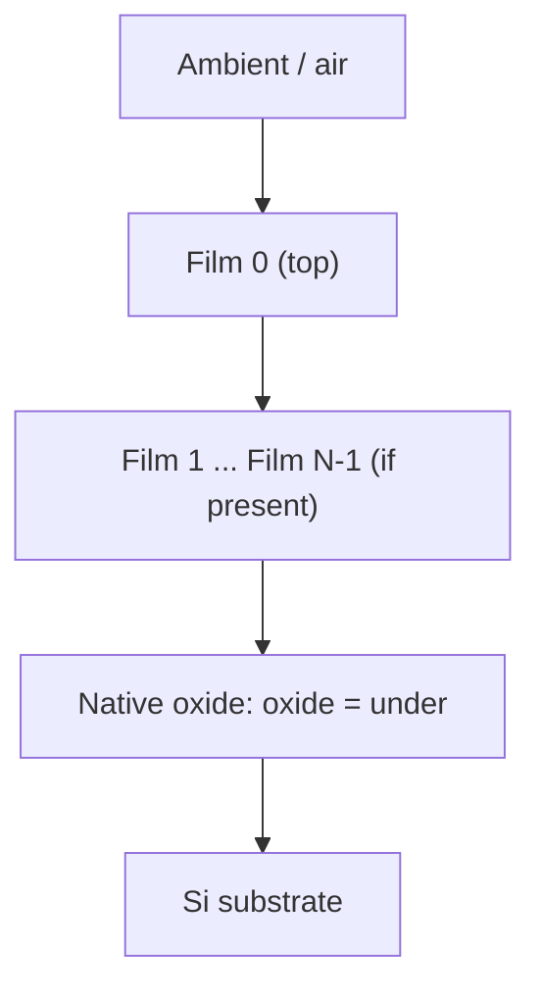

# Visual guide to synthetic X-ray reflectivity

ReflectoSim is a **distribution generator**, not an independent XRR forward solver. It samples a physical multilayer and an instrument configuration, calls [ReflectoFit](https://github.com/NaNIsaac/ReflectoFit) to evaluate the pre-noise signal, and adds counting noise. All figures below are either generated from the checked-in example prior or are explicitly labeled as architectural diagrams.

## 1. Data generation at a glance


Each row is an independent sample of the specified *joint prior*. ReflectoSim uses separate random streams for structure/instrument parameters and counting noise. Pre-noise curves are computed in chunks, while noise is drawn in fixed 4096-row blocks to make the result independent of the forward chunk setting. **Exact counts also depend on ReflectoFit/NumPy versions and numerical settings.**

## 2. What the example actually samples


These bars display the *endpoints of each variable's own interval*, not a common numeric axis and not the resulting marginal density. See [examples/lab_films.toml](../examples/lab_films.toml) for the full prior.

| Parameter | Example prior | Interpretation |
| --- | --- | --- |
| Film count | 1–3 | Variable-length multilayer |
| Film thickness | 20–250 Å | Uniform proposal, constrained together with roughness |
| Film roughness | 2–10 Å | Additionally limited by `roughness_max_ratio = 0.25`, so σ ≤ d/4 |
| Film real SLD | 5–80 × 10⁻⁶ Å⁻² | Neighboring media must satisfy `min_contrast = 4` |
| Film imaginary/real SLD ratio | 0.005–0.05 | Absorption parameter |
| Oxide thickness | 5–25 Å | Explicitly configured below the film stack |
| Oxide real SLD | 17.2–19.7 × 10⁻⁶ Å⁻² | Native oxide prior |
| Gaussian resolution σq | 0.0005–0.003 Å⁻¹ | Instrumental broadening |
| 2θ offset | −0.01° to +0.01° | Angular calibration error |
| Counts scale | 10⁶–10⁸ | Counts at R = 1 (`log_counts` is base-10) |

**Important:** constraints couple parameters, so a simple rectangular range plot is *not* the true joint sampling distribution. Even when individual interval proposals are uniform, the accepted sample distribution can differ due to constraints.

## 3. Actual generated XRR curves


This is the existing **simulation output**, not a conceptual sketch. Recreate the figure with:

```sh
uv sync
uv run --with matplotlib docs/media/make_figure.py
```

The chart uses the checked-in prior, seed `(20261024, 7)`, four structures, and a fixed 2θ grid of 0.05°–8° with 500 points. Curves are offset vertically by three decades for legibility. **Do not interpret vertical separation as a physical change in intensity.**

The solid lines are `batch.reflectivity`, i.e. pre-noise *observed intensity* including instrument effects, background, and intensity scale; they are not necessarily the bare Fresnel/Parratt reflectivity. Dots are `batch.counts / batch.counts_scale` after Poisson sampling. Zero-count points are omitted on a logarithmic plot. Note that applying a logarithm or normalizing counts does **not** undo Poisson noise.

## 4. Structure and instrument contributions

A stack is packed from ambient to substrate, with the oxide location made explicit:



Set `oxide = "over"` to put the oxide *above* the films, or `oxide = "none"` to omit it. This changes interface order and thus the interference structure. Missing films are encoded as zero-thickness, matched-media layers so that batching can use fixed-width arrays without introducing extra interfaces.

Conceptually, the pipeline can be represented as

```text
sample stack, instrument → ReflectoFit.forward(q, stack, instrument)
                         → pre-noise observed intensity μ(q)
                         → λ(q) = counts_scale × μ(q)
                         → counts(q) ∼ Poisson(λ(q))
```

The `reflectivity` dataset key currently names **μ**, even though it includes the instrument intensity and background. Keep that distinction in mind when training models.

## 5. Reproducing a dataset and auditing it

```sh
uv run reflectosim sim --prior examples/lab_films.toml --n 1000 --seed 20261024,1 -o train.npz
uv run reflectosim describe train.npz
```

- `q`: shared momentum-transfer grid (Å⁻¹).
- `counts`: Poisson counts per curve and q point.
- `reflectivity`: pre-noise signal used to generate counts.
- `counts_scale`: rowwise multiplier converting pre-noise signal to expected counts.
- `layer0.thickness`, `oxide.sld`, `tth_offset`, etc.: rowwise sampled parameters. A non-existent layer has NaN in the descriptive parameter table.
- Metadata: priors, random seed, package/version and reproduction context.

### Scientific caveats

1. **Synthetic is not validated experimental realism.** Noise, background, footprint, roughness and resolution are modeled, but their prior ranges must be checked against a real instrument and sample population.
2. **Forward-model matching is not an independent test.** ReflectoFit generates the simulated curves, so agreement with ReflectoFit alone cannot validate the physical model against measured data.
3. **Resolution accuracy is not free.** Default per-point adaptive integration is preferred for sharp edges. Fixed `nodes` must be justified against an explicit error budget; see [docs/index.md](index.md).
4. **Reproducibility is conditional.** Pin software versions and numerical settings, preserve the TOML and metadata, and compare saved arrays when modifying the pipeline.

## 6. Useful next scientific figures

The next stage should generate plots **from data**, not from hand-drawn curves: sampled-thickness/SLD/roughness histograms, q-dependent Poisson residuals, edge-resolution sensitivity, oxide-order comparisons, and convergence of numerical quadrature. These require recorded samples or controlled parameter sweeps and should state axes, units, seeds, and the exact forward-model version. This visual guide deliberately makes no performance or realism claims based on figures that have not been computed.
